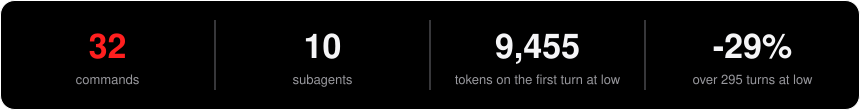
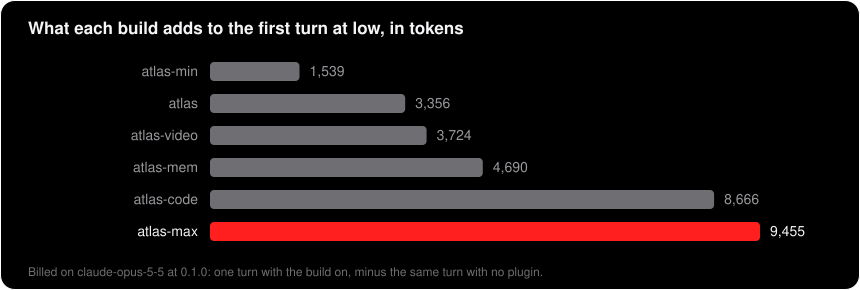
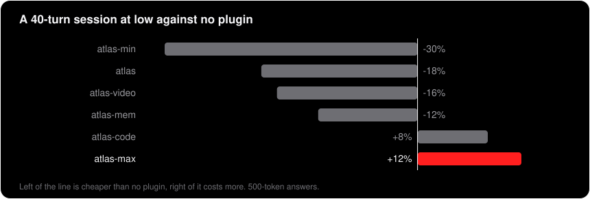

<p align="center"></p>
<p align="center"></p>

**Every part of ATLAS in one install.** It exists because two ATLAS builds side by side inject the rules and the reminder twice: this is the only way to have coding, the memory and video together.

```
/plugin marketplace add Z0CC0/ATLAS
/plugin install atlas-max@atlas
```

It ships off, and nothing changes until you type `atlas low` or `atlas high`. `atlas help` prints every command.

## What is inside

| part | what it gives you | read more |
|---|---|---|
| **The rules** | four dials: answers up to 51% shorter, questions before building, checks before claims, silence on request | [ATLAS](https://github.com/Z0CC0/ATLAS) |
| **Coding** | review, fix, plan, test, verify, ship, security audit, specs and changelogs | [ATLAS-code](https://github.com/Z0CC0/ATLAS-code) |
| **Memory** | notes flagged when their code changes, a code graph, labels, a reader of shipped programs | [ATLAS-mem](https://github.com/Z0CC0/ATLAS-mem) |
| **Video** | screen recording with a camera that follows you, and video with frameworks on your machine | [ATLAS-video](https://github.com/Z0CC0/ATLAS-video) |

Each of those pages explains its part in full, says where others do it better, and lists what can be connected from outside.

## What it costs

It is the dearest ATLAS: 6,955 tokens in every chat even when switched off, and 9,455 on the first turn at `low`.

<p align="center"></p>
<p align="center"></p>

| build | what it is | commands | subagents | installed, switched off | first turn at `low` | first turn at `high` | 40 turns at `low` | 295 turns at `low` |
|---|---|---|---|---|---|---|---|---|
| [`atlas`](https://github.com/Z0CC0/ATLAS) | the rules, the dials, search and the browser | 6 | 2 | 1,238 | 3,356 | 3,536 | -18% | -33% |
| [`atlas-min`](https://github.com/Z0CC0/ATLAS/tree/main/atlas-min) | compression only | 1 | 0 | about 0 | 1,539 | 1,721 | -30% | -36% |
| [`atlas-video`](https://github.com/Z0CC0/ATLAS-video) | `atlas` plus video made on your machine | 8 | 2 | 1,601 | 3,724 | 3,905 | -16% | -33% |
| [`atlas-mem`](https://github.com/Z0CC0/ATLAS-mem) | `atlas` plus review, fix, a memory and a program reader | 11 | 5 | 2,569 | 4,690 | 4,873 | -12% | -32% |
| [`atlas-code`](https://github.com/Z0CC0/ATLAS-code) | `atlas` plus coding and documents | 28 | 10 | 6,167 | 8,666 | 8,886 | +8% | -29% |
| [`atlas-max`](https://github.com/Z0CC0/ATLAS-max) | all of it | 32 | 10 | 6,955 | 9,455 | 9,672 | +12% | -29% |

Below about 54 turns at `low` it costs more than no plugin. If you do not use all of it, a smaller build gives the same result for less. The savings on this build are assumed from `atlas`, not measured.

## Against the one project of this size

[ECC](https://github.com/affaan-m/ECC) (295,521 stars on 2026-11-02, MIT) is the all-in-one that the coding part was written after reading. ATLAS max loads 4,589 tokens of names and descriptions in every chat, and ECC 27,066, counted the same way. ATLAS also shortens answers, which we did not find in ECC as a skill. ECC does far more: 314 skills, learned instincts, parallel sessions and other hosts such as Codex and Cursor. Pick ATLAS for the cost and the measured numbers, and ECC for the breadth.

## Connections

Everything that can be attached from outside, with its advantages and disadvantages: [`connections.md`](connections.md).

---

MIT licence. The bench behind every figure is in [ATLAS](https://github.com/Z0CC0/ATLAS).
